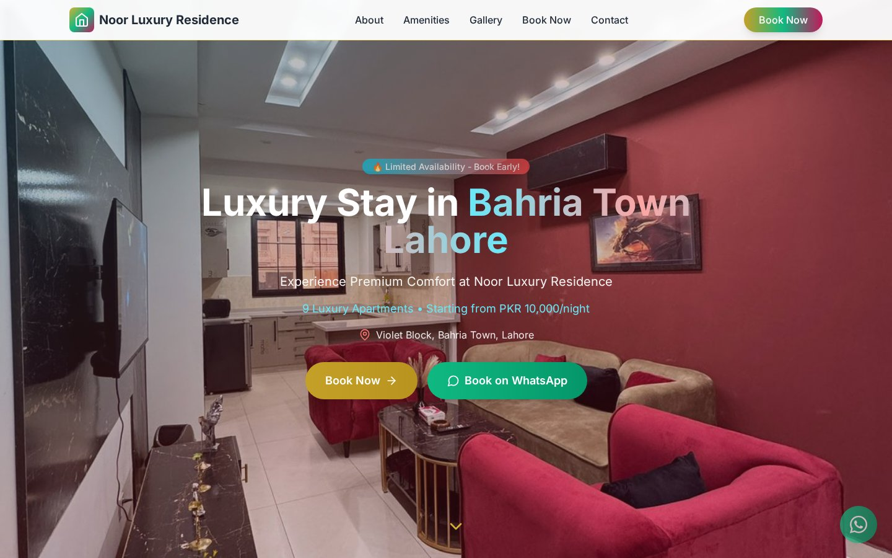
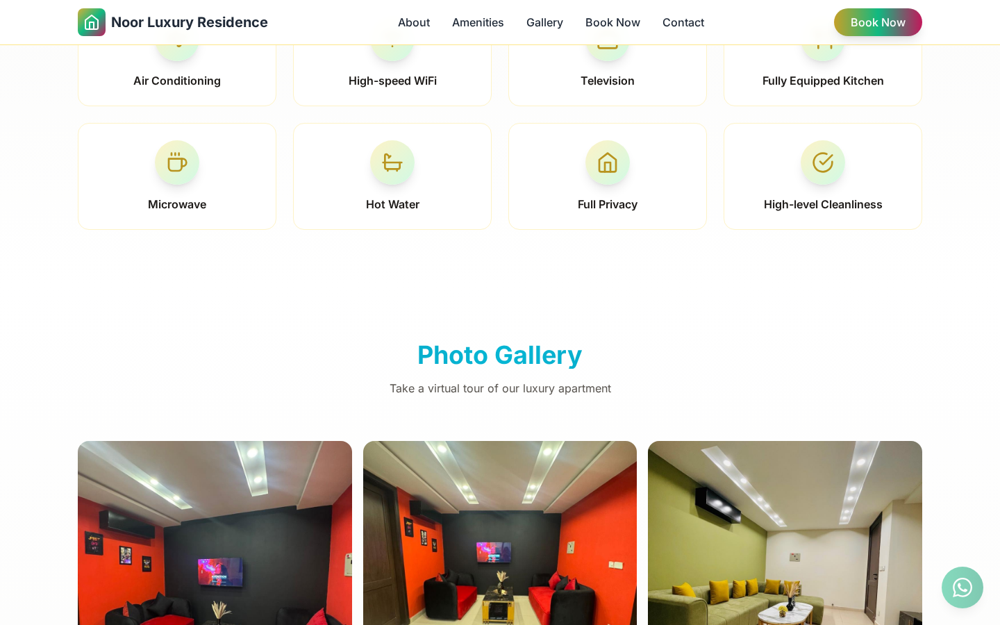
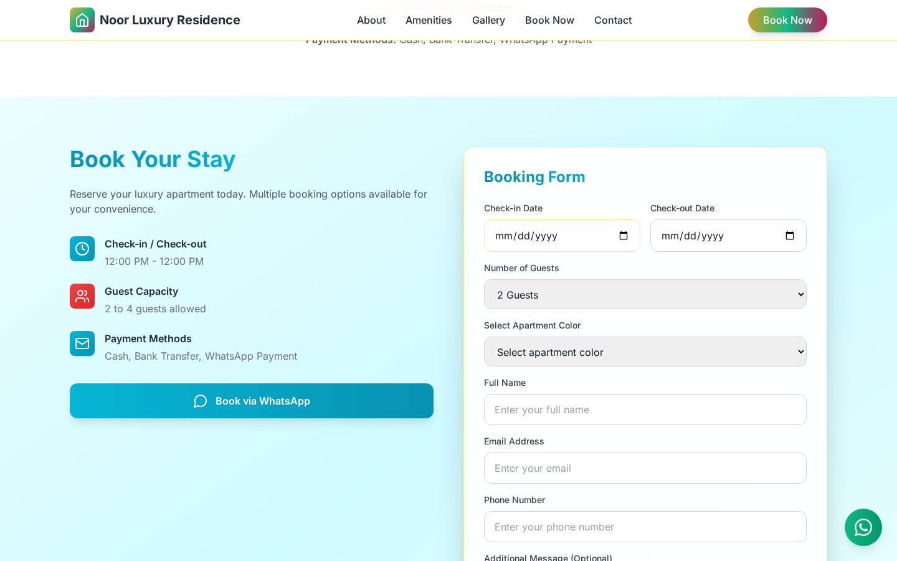
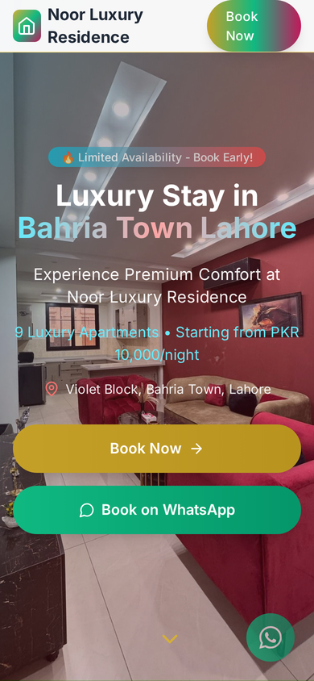

<h1 align="center">Noor Luxury Residence — Bahria Town</h1>

<p align="center"><em>Premium short-stay apartment website for Bahria Town, Lahore</em></p>

<p align="center">
  
  
  
</p>

<p align="center"><a href="https://noor-luxury-residence-bahria-town.netlify.app/"><strong>🔗 Live Demo</strong></a></p>

<p align="center"></p>

## 📖 Overview

A premium property presentation website for **Noor Luxury Residence** in Violet Block, Bahria Town, Lahore — designed to showcase luxury accommodation and give visitors all the property information they need, from amenities and photos to pricing and booking.

## ✨ Features

- Hero section with availability badge, nightly rate and quick **Book Now / Book on WhatsApp** buttons
- Apartment overview — entire apartment, 2–4 guests, prime location
- **Apartment features** and **premium amenities** (WiFi, TV, kitchen, hot water, privacy, cleanliness)
- **Photo gallery** of the apartments
- **Pricing & rates** card (PKR per night) and payment methods
- **Booking form** — check-in/out dates, guests, apartment color, contact details
- House rules, location with Google Maps link, and contact section
- Fully responsive design with smooth animations

## 🛠️ Tech Stack

| Layer | Technology |
|---|---|
| UI library | React |
| Styling | Tailwind CSS |
| Build tool | Vite |
| Animation & icons | Framer Motion, Lucide icons |
| Hosting | Netlify |

## 📸 Screenshots

**Home**


**Section 1**



**Section 2**



**Mobile**



## 🌐 Live Demo

https://noor-luxury-residence-bahria-town.netlify.app/

## 🚀 Getting Started

No build step needed — it's a static site.

```bash
git clone https://github.com/Mo-aini/noor-luxury-residence-bahria-town.git
cd noor-luxury-residence-bahria-town
```

Then open `index.html` in your browser, or serve the folder locally:

```bash
# Option 1: Python
python -m http.server 8000
# Option 2: Node
npx serve .
```

Visit `http://localhost:8000`. You can also use the **Live Server** extension in VS Code.


## 📁 Project Structure

```
noor-luxury-residence-bahria-town/
├── assets/
│   ├── index-CHwZh2--.css
│   └── index-DmoEpmtD.js
├── images/
│   └── … (8 files)
├── screenshots/
│   ├── home.jpg
│   ├── mobile.png
│   ├── section-1.png
│   └── section-2.png
├── .gitignore
├── index.html
├── LICENSE
└── README.md
```

## 📝 Notes

This repository contains the **production build** of the site (`index.html` + compiled `assets/`) exactly as deployed. Because the bundle loads assets from absolute paths (`/assets`, `/images`), serve the folder from its root with a local server rather than opening the file directly.

---

<div dir="rtl">

## 🇾🇪 بالعربي

موقع عقاري فخم لـ **Noor Luxury Residence** في بحرية تاون، لاهور: يعرض الشقق والمميزات والصور والأسعار، وفيه نموذج حجز وحجز مباشر عبر الواتساب وموقع العقار على الخريطة.

**التقنيات:** React و Tailwind CSS و Vite (النسخة المرفوعة هي نسخة الـ build الجاهزة).

**التشغيل:** شغّل سيرفر محلي داخل المجلد (`python -m http.server 8000`) وافتح `localhost:8000`.

**الرابط المباشر:** https://noor-luxury-residence-bahria-town.netlify.app/

</div>

---

## 👤 Author

**Mohammed Emad ALaini** — Software Engineering student & Full-Stack Developer

- Portfolio: [mohammedemad.netlify.app](https://mohammedemad.netlify.app/)
- GitHub: [@Mo-aini](https://github.com/Mo-aini)
- LinkedIn: [Mohammed Emad](https://www.linkedin.com/in/mohammed-emad-24a841373)

## 📄 License

This project is licensed under the [MIT License](LICENSE).
